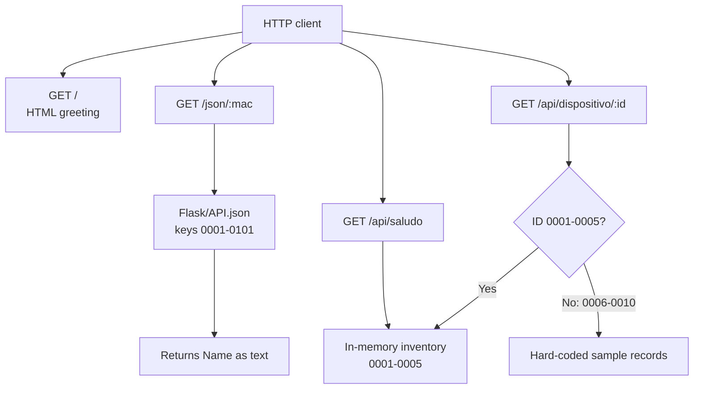

# Flask Network Device API

A small Flask application that serves a sample network-device inventory and looks up device names from `Flask/API.json`.

## Project files

- `Flask/App.py`: Flask application, in-memory device inventory, and HTTP routes.
- `Flask/API.json`: device records used by the `/json/<mac>` route. Keys currently range from `0001` to `0101`.
- `req.txt`: Python package requirements.

## Run locally

From the project root, install the dependencies and start the application:

```powershell
python -m pip install -r req.txt
python Flask/App.py
```

The development server runs at `http://127.0.0.1:5000`. The application is configured with Flask debug mode enabled; do not use this development configuration in production.

## Routes

All routes use `GET` (Flask's default). The base URL below is `http://127.0.0.1:5000`.

| URL | Behavior |
| --- | --- |
| `/` | Returns a small HTML page with a greeting and a link to `/api/saludo`. |
| `/json/<mac>` | Looks up `<mac>` in `API.json`, prints the record's protocols, VLANs, and status to the server console, and returns its `Name` as plain text. Existing keys are `0001` through `0101`; an unknown key currently raises a `KeyError` and results in a server error. |
| `/api/saludo` | Returns the complete in-memory `dispositivos` dictionary as JSON. It contains the five devices initialized when the application starts. |
| `/api/dispositivo/0001` | Returns the in-memory record for Router Principal (`192.168.1.10`). |
| `/api/dispositivo/0002` | Returns the in-memory record for Switch Capa 3 (`192.168.1.20`). |
| `/api/dispositivo/0003` | Returns the in-memory record for Access Point (`192.168.1.30`). |
| `/api/dispositivo/0004` | Returns the in-memory record for Firewall (`192.168.1.40`). |
| `/api/dispositivo/0005` | Returns the in-memory record for Servidor DNS (`192.168.1.50`). |
| `/api/dispositivo/0006` | Returns a hard-coded sample for Servidor DHCP (`192.168.1.60`); it is not added to the in-memory inventory. |
| `/api/dispositivo/0007` | Returns a hard-coded sample for Balanceador de carga (`192.168.1.70`); it is not added to the in-memory inventory. |
| `/api/dispositivo/0008` | Returns a hard-coded sample for Modem de fibra óptica (`192.168.1.80`); it is not added to the in-memory inventory. |
| `/api/dispositivo/0009` | Returns a hard-coded sample for Switch PoE (`192.168.1.90`); it is not added to the in-memory inventory. |
| `/api/dispositivo/0010` | Returns a hard-coded sample for Servidor Proxy (`192.168.1.100`); it is not added to the in-memory inventory. |

Example full URL: `http://127.0.0.1:5000/api/dispositivo/0001`.

## Route map



The device route is implemented as ten separate fixed URLs, not as a variable `<id>` route. IDs `0001` to `0005` read the initialized inventory; IDs `0006` to `0010` return separate hard-coded examples.

## Git branches

| Branch | Observed or inferred role |
| --- | --- |
| `feature/FlaskV01` | Local branch for this Flask app. It was an unborn branch before the requested initial commit. |
| `main` | Remote default branch (`origin/HEAD` points here); conventionally the stable integration branch. |
| `Feature` | Remote branch; its name suggests feature work. |
| `Hotfix` | Remote branch; its name suggests urgent fixes. |
| `Release`, `Release2`, `Release3`, `Release4` | Remote release-named branches; their specific release/version meanings are not documented. |

At inspection, every remote branch pointed to the same `Initial commit`, which contained only a placeholder `README.md`. Therefore, the branch names suggest intended roles, but there is no branch-specific history or code to confirm them. The local `feature/FlaskV01` branch had no commit before this work. For future work, prefer `feature/<name>` for features, `hotfix/<name>` for urgent fixes, and `release/<version>` for release preparation, then merge reviewed changes into `main`.

## Current limitations

- The inventory is in memory and resets to its five initial devices whenever the process restarts.
- The `/json/<mac>` route uses direct dictionary indexing and does not handle unknown keys.
- The device endpoints are individually hard-coded; there is no general `/api/dispositivo/<id>` route.
- Flask debug mode is enabled for local development only.